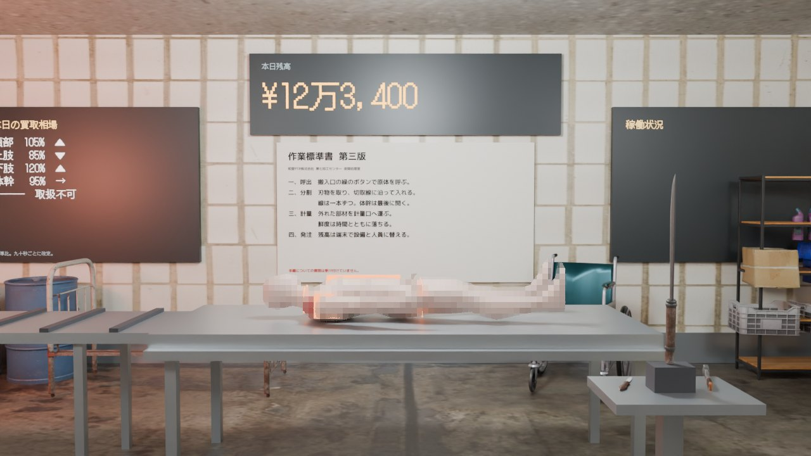
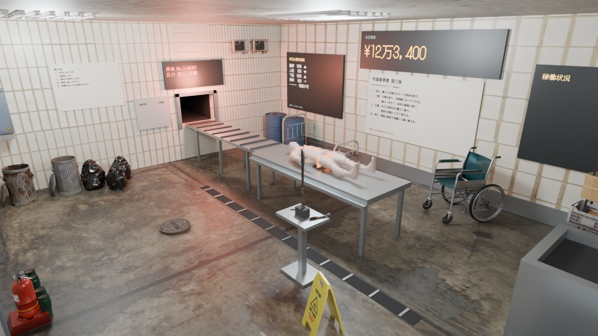
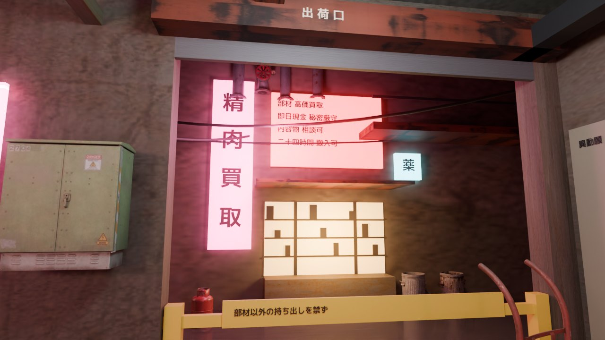
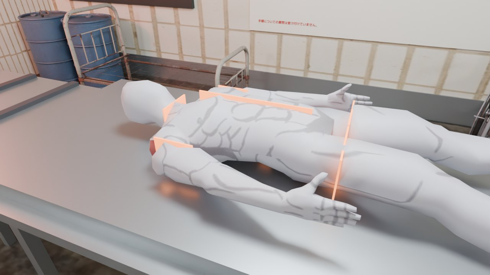
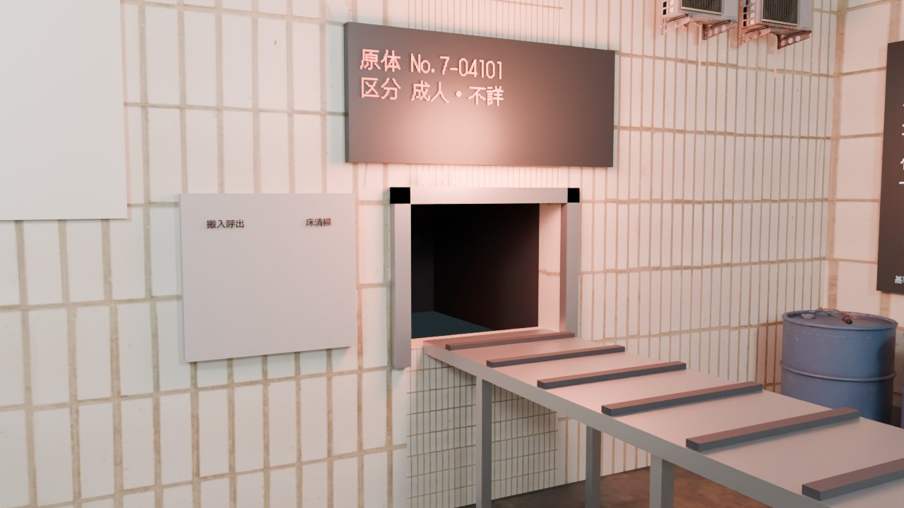
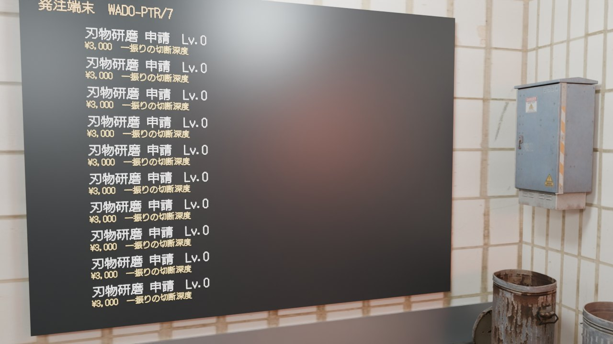
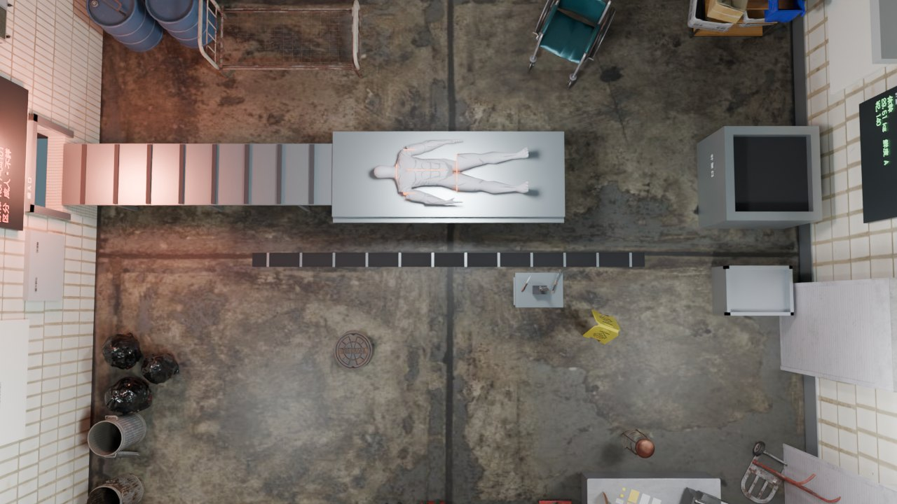

# 和堂PTR 第七加工センター 夜間処理室

VRChat ワールド(PC / デスクトップ・VR 両対応)。フリー素材だけで組んだ、人を捌いて売るインクリメンタルゲームです。

巨大構造体の底、配線と配管に埋もれた路地裏。濡れたコンクリートに桃色と赤のネオンが滲む一角に、下請けの解体屋があります。あなたはそこの夜勤として打刻されます。搬入口から「原体」が届き、切取線に沿って刃物を入れ、外れた「部材」を計量口へ運ぶ。残高は発注端末で設備と人員に替わり、やがて手を動かさなくても出荷額は増えていきます。出荷口の柵の向こうには、看板と窓明かりの路地が見えます。出ることはできません。

ゲームとしての説明文は世界のどこにもありません。あるのは作業標準書、衛生掲示、相場表、伝票、名簿、そして前任者の走り書きだけです。

| 天井の隅から | 出荷口と外の路地 |
|---|---|
|  |  |
| 処理台(原体は修整モザイクで覆われる) | 搬入口 |
|  |  |
| 発注端末 | 上から |
|  |  |

(画像は `Tools/preview_layout.py` による Blender での確認用描画です。表示器の数字は仮のもの、ボタン・扉・付箋などスクリプトが作る部品は写っていません。ネオンのにじみと霧は後処理で近似しています)

## 開き方

1. [VRChat Creator Companion](https://vcc.docs.vrchat.com/)(または ALCOM)で **Add Existing Project** からこのフォルダを追加する。
   Unity は **2022.3.22f1**、VRChat SDK - Worlds は **3.10.6** で固定してあります(`Packages/vpm-manifest.json`)。
2. プロジェクトを開く。初回は SDK の導入とインポートに数分かかります。
3. 「処理室のシーンがまだありません。いま建てますか?」と聞かれたら **建てる**。
   あとからでも、メニュー **WadoPTR > 処理室を建てる (Build World Scene)** でいつでも建て直せます。
   - TextMesh Pro の基本リソースが未導入なら先にその導入を促します。導入後にもう一度メニューを実行してください。
4. `Assets/WadoPTR/Scenes/WadoPTR.unity` が生成されて開きます。再生ボタン(ClientSim)か、**VRChat SDK > Show Control Panel > Build & Test** で試せます。

シーンはリポジトリに含めていません。`Assets/WadoPTR/Editor/WadoWorldBuilder.cs` が設計図 `layout.json` から毎回同じものを組み立てます。

## 遊び方(世界の中では、こうは書かれていません)

| やること | デスクトップ | VR |
|---|---|---|
| 原体を呼ぶ | 搬入口の横の緑のボタンをクリック | 同じボタンを押す |
| 切る | 刃物を持ち、**切取線を見て左クリック** | 刃物を持ち、**切取線に向けて実際に振る**(引き金でも可) |
| 売る | 外れた部材を持って計量口へ入れる | 同じ |
| 強くする | 手前の壁の発注端末のボタン | 同じ |

- 四肢と頭部を外すと、体幹の切取線が現れます。
- 鮮度は搬入からの時間で「特 → A → B → C」と落ち、買取額が変わります。相場は 90 秒ごとに改定されます。
- 「搬送ベルト」を設置すると部材は自動で計量口へ流れ、「特定部材 取扱許可」で体幹から内容物が採れるようになります。
- 「夜間補助員」以降の 5 系統は常時収益です。ワールドを離れている間も、最大 8 時間ぶんが半分の効率で積み上がります。
- 「異動願」は周回(プレステージ)です。残高と設備を手放す代わりに、評価点が恒久的に出荷額を押し上げます。
- 進行は各自のアカウントに保存されます(VRChat の Persistence / PlayerData)。同じインスタンスにいる人はそれぞれ自分の処理室を進め、名簿には互いの肩書きが載ります。

累計出荷額が増えるにつれて、部屋に付箋が増え、床が汚れ、肩書きが変わり、やがて左の壁に一枚の表が貼り出されます。

## 設計の要点

- **説明を世界の内側に置く** — 手順は「作業標準書」、数値は表示器と伝票、操作の動詞は VRChat 標準のツールチップ(「搬入呼出」「発注」「切る」)に載せています。
- **押す・持つ・切るの 3 操作だけ** — すべてのボタンは `Interact`、部材と刃物は `VRCPickup`。uGUI は使っていないので、デスクトップと VR で挙動が変わりません。
- **修整モザイク** — 原体の 6 部位には、同じメッシュを少し膨らませて重ね、`WadoPTR/Mosaic` シェーダーでブロック状に塗りつぶしています(付いている間も、切り離して運ぶ間も)。ローポリの素体でも「映してはいけないもの」に見え、細部は見る側が補います。格子は画面ではなくワールド空間に固定してあるので、VR で左右の目のブロックがずれません。切取線は `WadoPTR/Guide` でモザイクの上に描きます。ブロックの大きさは生成された `Generated/Materials/mosaic.mat` の Block Size で変えられます。
- **ネオンと暗がり** — 光源は裸電球 2 つ、切れかけの蛍光灯 1 本、あとはネオンの色のライトだけです(計 7 灯、すべてリアルタイム・影なし)。ネオン管と看板は Unlit、にじみは `WadoPTR/Glow` の加算の板、濡れた床の映り込みはリアルタイムの Reflection Probe、奥行きは霧で出しています。ポストプロセスのパッケージには依存していません(Bloom を足せばさらに近づきます)。
- **切断判定は物理に頼らない** — 刃の位置・速度と切取線の距離を毎フレーム計算します(`WadoBlade` / `WadoBody`)。レイヤーやトリガーの設定ずれで切れなくなることがありません。
- **進行はローカル、保存は PlayerData** — VRChat 公式の Persistent Idle Game サンプルと同じ方式(`OnPlayerRestored` を待ってから読み書き)。同期オブジェクトはありません。

| スクリプト | 役割 |
|---|---|
| `WadoGame` | 残高・発注・相場・肩書き・保存/復元・表示の更新 |
| `WadoBody` | 搬入、切取線の管理、部材の分離、受け皿への回収 |
| `WadoPart` | 部位/内容物ひとつ。付着 → 分離 → 計量の状態 |
| `WadoBlade` | 刃物。VR の振りとデスクトップの視線の両方を判定 |
| `WadoButton` / `WadoChute` / `WadoAmbience` | 押しボタン / 計量口 / 蛍光灯のちらつきと水滴 |

## 確認できたこと・できていないこと

このリポジトリは Unity を起動できない環境で作りました。そのため、次の線引きがあります。

**確認済み**

- 部屋の見た目 — `Tools/preview_layout.py` が Unity と同じ `layout.json`・同じ FBX・同じ書体を Blender で描画します(上の画像と `Docs/` の画像)。配置、向き、日本語の掲示はこれで目視確認しています。
- 全 C# の構文(tree-sitter)と、U# スクリプトが呼ぶ API 名が Udon の公開一覧(SDK 3.10.6 の DLL から抽出した約 3.3 万件)に存在すること — `Tools/lint_udon.py`。
- エディタ API の名前と引数は SDK 3.10.6 同梱の UdonSharp のソースと突き合わせています。

**未確認(Unity で初めて分かること)**

- **UdonSharp での実コンパイルと、実機での動作。** 型の不一致など、上の検査では拾えない誤りが残っている可能性があります。エラーが出たら Console の内容をそのまま教えてください。
- モザイクシェーダーの実機での見え方(GrabPass を使うので PC 専用。VR のシングルパス描画には対応する書き方をしていますが、実機未確認です)。
- TextMesh Pro の文字の実寸(大きすぎる/小さすぎる場合は `WadoWorldBuilder.cs` の `TextScale` を変えて建て直す)。
- 刃物を持ったときの向き、ボタンの押しやすさ、音量バランスなどの手触り。
- 明るさと色の実機での見え方。暗すぎる場合は `WadoWorldBuilder.cs` の `ambientLight` と `Tools/gen_layout.py` の `light(...)` の強さを上げてください。
- ライトはすべてリアルタイム(ベイクなし)です。重い場合や質感を上げたい場合は、生成後にライトマップをベイクしてください。

## 素材を作り直す

外部素材の取得から変換までをスクリプトにしてあります(`pip install bpy pillow numpy py7zr`、および ffmpeg が必要)。

| スクリプト | すること |
|---|---|
| `Tools/fetch_polyhaven.py` → `convert_polyhaven.py` | Poly Haven の API から什器を取得し、結合・減面・原点調整して FBX 化 |
| `Tools/build_body.py` | CC0 の人体メッシュを 6 部位に分割し、切断面を付ける |
| `Tools/build_audio.py` | CC0 効果音の切り出しと、環境音・チャイム等の合成 |
| `Tools/build_stains.py` | 汚れのテクスチャを生成 |
| `Tools/gen_layout.py` | 部屋と路地の設計図 `layout.json` と材質表 `models.json` を書き出す |
| `Tools/gen_credits.py` | `CREDITS.md` の素材表を作り直す |
| `Tools/gen_metas.py` | U# スクリプトの `.meta` と Program Asset を書き出す |
| `Tools/preview_layout.py` | 設計図を Blender で描画する。視点は名前(`spawn` `work` `corner` `alley` `dock` `hatch` `terminal` `top` …)か、`"目x,y,z:注視x,y,z:画角"` で自由に指定できる |
| `Tools/extract_udon_externs.py` → `lint_udon.py` | SDK の DLL から Udon 公開 API の一覧を抜き出し、構文と API 名を検査 |

部屋の配置を変えたいときは `Tools/gen_layout.py` を編集して実行し、Unity で建て直してください。

## ライセンス

外部素材の出典とライセンスは [CREDITS.md](CREDITS.md) にまとめています(モデル・テクスチャ・人体・効果音は CC0、書体は SIL OFL 1.1)。
